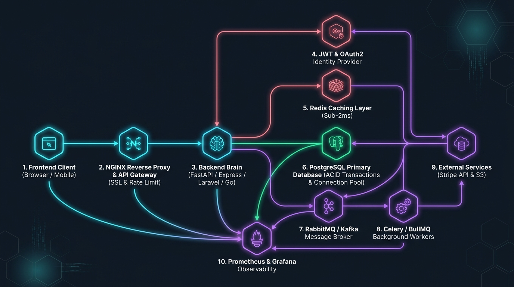

# Enterprise Backend Ecosystem Architecture & Lifecycle Platform

[](https://github.com/Pradeeptalari14/tp-backend-ecosystem/actions/workflows/ci.yml)
[](LICENSE)
[](docker-compose.yml)
[](projects/ecommerce-order-engine/)
[](projects/notification-event-hub/)
[](projects/saas-billing-dispatcher/)

> **Interactive Studio Workspace**: [Talari Pradeep Backend Ecosystem Studio](https://pradeeptalari.com/tools/backend-ecosystem/)  
> **Conceptual Foundation**: Inspired by Cloud X Berry's foundational video *"I Bet Nobody Has Ever Explained the Backend Ecosystem Like This Before"*.

---

## 🏛️ Architecture Overview

The backend is not just an API server; it is an interconnected ecosystem of ingress proxies, authentication services, distributed memory caches, relational transactional storage, message queues, asynchronous background consumers, external SaaS integrations, and observability pipelines.



---

## 🔄 The 10-Stage Request Lifecycle Anatomy

When an end-user taps **"Place Order"** or interacts with a cloud application, the request travels through 10 distinct architectural stages:

| Stage | Component | Technology | Role & Latency Profile |
|---|---|---|---|
| **1. Client Ingress** | Browser / Mobile | HTTP/2, REST, JSON | Emits payload with JWT Authorization header and unique `Idempotency-Key` (~2ms). |
| **2. Reverse Proxy / Gateway** | Ingress Controller | NGINX, Caddy, Traefik | SSL/TLS termination, DDoS protection, rate limiting via token bucket algorithm (~1ms). |
| **3. Auth & Identity** | Security Gate | JWT, OAuth2, OIDC | Cryptographic verification of Bearer token signature without hitting central DB (~0.5ms). |
| **4. In-Memory Cache** | Low-Latency Store | Redis, Memcached | Validates inventory availability and prevents duplicate executions (sub-2ms). |
| **5. Persistent Database** | Transactional Storage | PostgreSQL, MySQL | ACID transaction: row-level lock (`SELECT FOR UPDATE`), ledger insert, atomic commit (~12ms). |
| **6. Message Broker** | Event Bus | RabbitMQ, Apache Kafka | Decouples caller from heavy processing; publishes persistent event message (~3ms). |
| **7. Background Workers** | Async Consumer | Celery, BullMQ, Asynq | Consumes queue, manages task retries, handles concurrency control (~150ms). |
| **8. External SaaS Services** | Third-Party APIs | Stripe, Twilio, SendGrid | Offloaded payment capture and SMS dispatch wrapped in Circuit Breaker (~240ms). |
| **9. Telemetry & Tracing** | Observability | OpenTelemetry, Prometheus | W3C `traceparent` propagation, RED metrics (Rate, Errors, Duration) (~0.8ms). |
| **10. Response Delivery** | Client Feedback | HTTP 201 Created | Synchronous HTTP response delivered to client in < 20ms while workers continue. |

---

## 📦 3 Production Projects Included

This repository contains **3 production-grade, fully runnable projects** demonstrating this architecture:

### 1. 🛒 [E-Commerce Order & Inventory Engine](projects/ecommerce-order-engine/)
- **Stack**: Python 3.11, FastAPI, Redis 7, PostgreSQL 16, Celery, Stripe Mock.
- **Highlights**:
  - Sub-2ms Redis inventory caching before committing to heavier PostgreSQL disk transactions.
  - Redis-backed distributed lock with 15-minute idempotency key TTL.
  - Celery background worker for payment processing and email notifications.
- **Run**: `cd projects/ecommerce-order-engine && uvicorn main:app --reload`

### 2. ⚡ [Real-Time Notification & Event Streaming Hub](projects/notification-event-hub/)
- **Stack**: Node.js 20, Express, WebSockets (`ws`), Redis Pub/Sub, BullMQ, PostgreSQL.
- **Highlights**:
  - Sub-10ms broadcast across multi-pod clusters using Redis Pub/Sub channel multiplexing.
  - Persistent WebSocket connection manager with client registry.
  - BullMQ persistent queue for mobile push fallbacks (APNS/FCM) and audit log retention.
- **Run**: `cd projects/notification-event-hub && npm install && npm start`

### 3. 💳 [Enterprise Multi-Tenant Billing & Webhook Dispatcher](projects/saas-billing-dispatcher/)
- **Stack**: Go 1.21, Gin, Redis, Asynq, MySQL 8.
- **Highlights**:
  - Transactional Outbox Pattern to guarantee event emission without dual-write inconsistencies.
  - HMAC-SHA256 signature generation on every outbound webhook payload.
  - Asynq worker with exponential backoff retries and Dead Letter Queue (DLQ).
- **Run**: `cd projects/saas-billing-dispatcher && go run main.go`

---

## 🛠️ Unified Multi-Container Deployment

Run the complete backend ecosystem with a single command:

```bash
docker-compose up -d
```

### Health Check Verification:
```bash
# Verify NGINX Ingress
curl -i http://localhost/health

# Verify E-Commerce Order API
curl -i http://localhost/api/v1/orders

# Verify Notification Hub
curl -i http://localhost:3000/health

# Verify SaaS Billing API
curl -i http://localhost:8080/health
```

---

## 🩺 SRE Troubleshooting Runbooks & Labs

| Failure Scenario | Root Cause | Production Remediation |
|---|---|---|
| **Database Pool Exhaustion** | Unpooled connections per HTTP request exceed PostgreSQL `max_connections`. | Deploy PgBouncer in transaction pooling mode; enforce formula `pool_size = (2 * cores) + disk_spindles`. |
| **Cache Stampede (Thundering Herd)** | Hot cache key expires; thousands of concurrent threads query DB simultaneously. | Implement XFetch probabilistic early expiration and Redis distributed mutex locks. |
| **Queue Lag & Worker OOM** | Poison-pill message fails parsing, causing infinite retries and memory leaks. | Configure Dead Letter Queue (DLQ) with `max_retries = 3` and worker memory cgroup limits. |
| **Upstream 504 Gateway Timeout** | Synchronous HTTP calls to Stripe/external APIs block backend threads. | Offload external calls to async workers; enforce 1s connect / 3s read timeouts and Circuit Breaker. |
| **Migration Deadlock** | Breaking schema migration dropped columns while old container version was active. | Enforce Expand-and-Contract (Parallel Change) migration workflow across deployments. |
| **CrashLoopBackOff** | Container boots before database credentials or DNS are resolved. | Implement retry backoff in DB driver; configure separate Kubernetes Readiness vs Liveness probes. |

---

## 🔗 Deep Inner Studio Connections

The Backend Ecosystem Studio connects directly into specialized studios across the Talari Pradeep engineering portfolio:

- [API Gateway Studio](https://pradeeptalari.com/tools/api-gateway/) — Ingress routing, rate limiting, and JWT validation.
- [NGINX Configurator](https://pradeeptalari.com/tools/nginx-config/) — SSL termination, upstream load balancing, and reverse proxying.
- [Local Cloud Dev Studio](https://pradeeptalari.com/tools/local-cloud-dev/) — Docker Compose multi-container workflows.
- [Database Migration Studio](https://pradeeptalari.com/tools/db-migration/) — Zero-downtime Flyway & Alembic migrations.
- [Database Clustering Studio](https://pradeeptalari.com/tools/db-clustering/) — PostgreSQL read replicas and connection pooling.
- [Redis Cache Studio](https://pradeeptalari.com/tools/redis-cesc/) — Sub-2ms memory caching and cache stampede protection.
- [Event-Driven SRE Studio](https://pradeeptalari.com/tools/event-sre/) — Kafka/RabbitMQ consumer lag and DLQ management.
- [Monitoring & Observability Studio](https://pradeeptalari.com/tools/monitoring/) — Prometheus alerting and Grafana dashboards.
- [OpenTelemetry Configurator](https://pradeeptalari.com/tools/otel-configurator/) — Distributed tracing with W3C headers.
- [DevSecOps Portfolio Guide](https://pradeeptalari.com/tools/devsecops-portfolio-guide/) — Container vulnerability gating and supply chain provenance.

---

## 📜 License & Author

- **Author**: Talari Pradeep
- **License**: [MIT](LICENSE)
